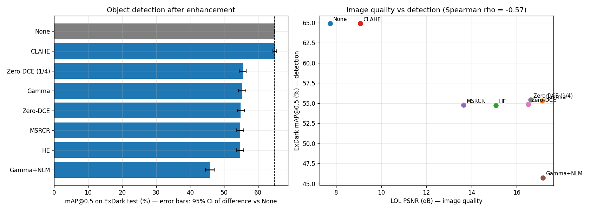
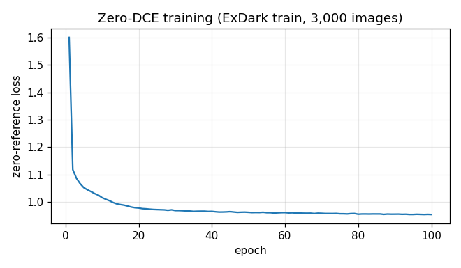
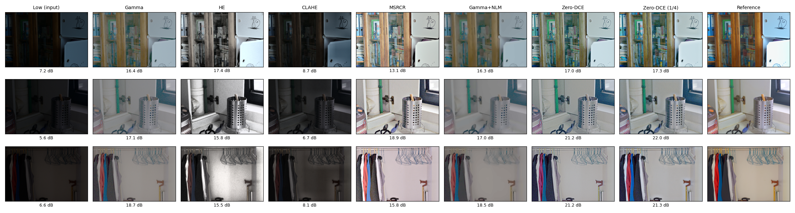
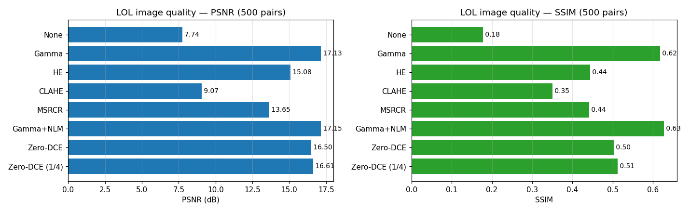
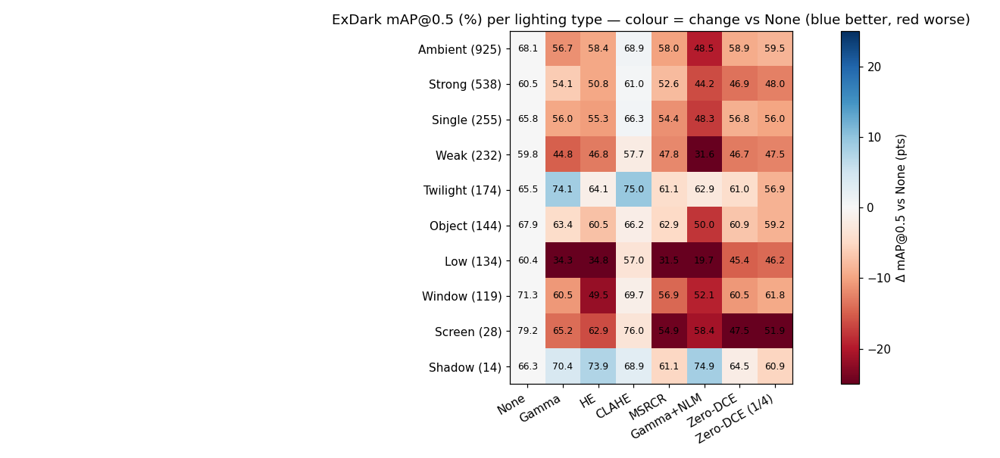
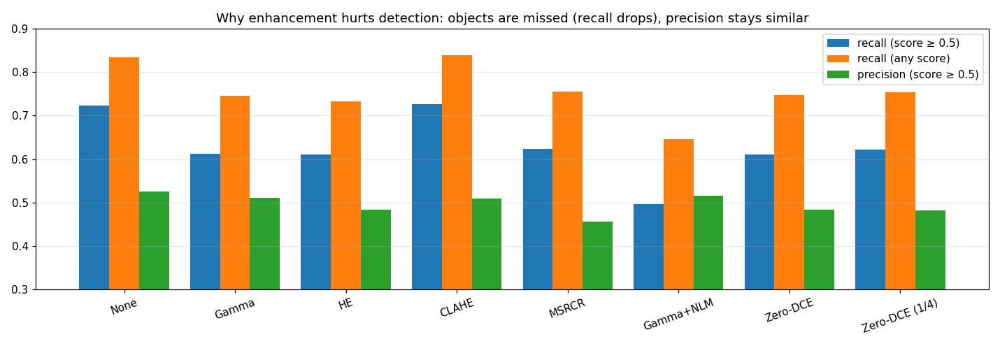

# Does Low-Light Enhancement Help Object Detection?

Six classical and two deep low-light enhancement methods, evaluated twice: for **image quality** on LOL and for
**object detection** on ExDark with a COCO-pretrained detector.

**Answer: no.** Methods that make dark images look better make the detector **worse** — about 10 mAP@0.5 points
lower, mainly because objects are missed. Only CLAHE is neutral.

[](https://colab.research.google.com/github/JamshedAli18/lowlight-enhancement-detection/blob/main/notebook/lowlight_enhancement.ipynb)



---

## Contents
1. [Key findings](#key-findings)
2. [Methods](#methods)
3. [Data and protocol](#data-and-protocol)
4. [Results — image quality (LOL)](#results--image-quality-lol)
5. [Results — object detection (ExDark)](#results--object-detection-exdark)
6. [Why enhancement hurts detection](#why-enhancement-hurts-detection)
7. [Speed](#speed)
8. [Limitations and future work](#limitations-and-future-work)
9. [Usage](#usage)
10. [Repository structure](#repository-structure)
11. [Data, licences and citations](#data-licences-and-citations)

---

## Key findings

1. **Enhancement hurts detection.** Every brightening method lowers ExDark mAP@0.5 by 9.5–10.2 points
   (bootstrap 95% CIs exclude zero); adding non-local-means denoising doubles the loss (−19.2). Only CLAHE is
   neutral (−0.03, CI [−0.59, +0.61]).
2. **Image quality does not predict detection.** Across the 8 methods, LOL PSNR and ExDark mAP@0.5 are negatively
   rank-correlated (Spearman ρ = −0.57, p = 0.14 — a trend, not significant with 8 points).
3. **The cause is missed objects, not false alarms.** Recall drops from 72% to ~61%, about 9% of objects become
   undetectable at any confidence, while false positives per image stay similar.
4. **A one-line classical method beats a trained network on image quality.** Adaptive gamma outperforms Zero-DCE
   on LOL (PSNR −0.63 dB and SSIM −0.114 for Zero-DCE, both significant).
5. **Zero-DCE can be 19× faster for free.** Estimating its curves at ¼ resolution cuts CPU time from 25.5 s to
   1.35 s per image and slightly *improves* PSNR (+0.11 dB, CI [+0.09, +0.13]).
6. **Where enhancement helps:** twilight images (+9.5 pts with CLAHE), boats (all methods), and on the darkest
   images Zero-DCE hurts far less than classical methods.

---

## Methods

| Method | Type | Description |
|---|---|---|
| None | baseline | Original dark image |
| Adaptive gamma | classical | Per-image gamma curve mapping mean luminance to 0.5 |
| HE | classical | Histogram equalisation of the luminance (Y) channel |
| CLAHE | classical | Contrast-limited adaptive equalisation of L (clip 2.0, 8×8 tiles) |
| MSRCR | classical | Multi-scale Retinex with colour restoration (σ = 15, 80, 250) |
| Gamma + NLM | classical | Adaptive gamma followed by non-local-means denoising |
| Zero-DCE | deep | DCE-Net (79,416 parameters) predicting 8 pixel-wise light-enhancement curves |
| Zero-DCE (¼) | deep | Same model; curves estimated at ¼ resolution, upsampled, applied at full resolution |

**Zero-DCE training:** zero-reference losses (spatial consistency, exposure E = 0.6, colour constancy,
illumination smoothness; weights 1 / 10 / 5 / 200), Adam lr 1e-4, batch 8, 256×256, **100 epochs on the ExDark
training split** (3,000 images, no reference images needed), final-epoch weights. LOL was never used for training.



---

## Data and protocol

- **LOL** — 500 real low/normal-light pairs (485 + 15 official test). Every method is scored on all 500 pairs
  (no method was trained on LOL); results on the 15 official test pairs are also reported.
- **ExDark** — 7,363 real low-light images, 12 object classes, 10 lighting conditions. **Official test split:
  2,563 images, 7,117 boxes.** Images resized to at most 800 px (longest side) before enhancement.
- **Detector:** torchvision Faster R-CNN ResNet-50 FPN v2, COCO-pretrained, **no fine-tuning**; ExDark classes
  mapped to COCO (People → person, Motorbike → motorcycle, Table → dining table).
- **Metrics:** PSNR / SSIM (LOL); COCO mAP and mAP@0.5 (ExDark, torchmetrics; custom AP@0.5 matches 0.6492 vs
  0.6491); paired bootstrap 95% CI (1,000 image resamples) for differences vs no enhancement; Wilcoxon signed-rank
  for per-image LOL comparisons.

---

## Results — image quality (LOL)

| Method | PSNR (500) | SSIM (500) | PSNR (15 test) | SSIM (15 test) |
|---|---|---|---|---|
| None | 7.74 | 0.178 | 7.77 | 0.191 |
| **Adaptive gamma** | 17.13 | 0.617 | 16.33 | **0.631** |
| HE | 15.08 | 0.444 | 14.24 | 0.425 |
| CLAHE | 9.07 | 0.351 | 9.13 | 0.357 |
| MSRCR | 13.65 | 0.442 | 13.42 | 0.477 |
| Gamma + NLM | **17.15** | **0.628** | 16.29 | 0.621 |
| Zero-DCE | 16.50 | 0.503 | **17.20** | 0.534 |
| Zero-DCE (¼) | 16.61 | 0.512 | — | — |

- Zero-DCE vs adaptive gamma (500 paired images): PSNR −0.63 dB, CI [−0.90, −0.37]; SSIM −0.114,
  CI [−0.121, −0.108]; Zero-DCE better on only 7% of images by SSIM. Its apparent lead on the 15 test images is
  small-sample noise.
- Denoising adds +0.02 dB for ~500× the runtime: on LOL, brightness and colour matter far more than noise.
- Note: PSNR on LOL strongly rewards matching the reference's global brightness.


*LOL official test images (input, all methods, reference); PSNR under each result.*



---

## Results — object detection (ExDark)

| Method | mAP | mAP@0.5 | Δ mAP@0.5 vs None | 95% CI |
|---|---|---|---|---|
| **None** | 0.336 | **0.649** | — | — |
| CLAHE | **0.336** | 0.649 | −0.03 | [−0.59, +0.61] |
| Zero-DCE (¼) | 0.282 | 0.554 | −9.47 | [−10.50, −8.42] |
| Adaptive gamma | 0.286 | 0.553 | −9.62 | [−10.73, −8.50] |
| Zero-DCE | 0.280 | 0.549 | −10.04 | [−11.04, −8.94] |
| MSRCR | 0.279 | 0.548 | −10.15 | [−11.21, −9.11] |
| HE | 0.285 | 0.547 | −10.19 | [−11.28, −9.13] |
| Gamma + NLM | 0.231 | 0.457 | −19.18 | [−20.45, −17.81] |

**By lighting condition** (number of test images in brackets):



- **Twilight (174):** enhancement helps — CLAHE 0.750 and gamma 0.741 vs 0.655 without enhancement.
- **Low, the darkest (134):** classical methods collapse (gamma 0.343 vs 0.604), while Zero-DCE degrades much less
  (0.454 / 0.462).
- Screen (28) and Shadow (14) are too small for conclusions.
- **By class:** boats are the only class improved by every method (0.445 → up to 0.487).

---

## Why enhancement hurts detection

At confidence ≥ 0.5 (7,117 ground-truth boxes):

| Method | Recall (≥ 0.5) | Recall (any score) | False positives / image | Precision | Mean confidence of correct detections |
|---|---|---|---|---|---|
| None | **0.723** | **0.835** | 1.81 | **0.525** | **0.839** |
| CLAHE | 0.726 | 0.839 | 1.94 | 0.509 | 0.841 |
| Adaptive gamma | 0.613 | 0.746 | 1.63 | 0.511 | 0.798 |
| HE | 0.611 | 0.733 | 1.81 | 0.483 | 0.810 |
| MSRCR | 0.623 | 0.755 | 2.07 | 0.456 | 0.803 |
| Gamma + NLM | 0.496 | 0.646 | 1.30 | 0.515 | 0.748 |
| Zero-DCE | 0.610 | 0.748 | 1.81 | 0.484 | 0.794 |
| Zero-DCE (¼) | 0.622 | 0.754 | 1.85 | 0.482 | 0.799 |



- Enhancement mainly **removes detections of real objects**: recall falls ~11 points and ~9% of objects are no
  longer detected at any score. False positives barely change.
- Correct detections become less confident (0.84 → ~0.80), suggesting enhanced images move *away* from the
  photographic statistics the COCO-trained detector learned (amplified noise, colour shifts, smoothing).
- Denoising removes noise **and** object detail: fewest false positives, worst recall.
- **Interpretation:** a modern detector is already fairly robust to darkness; enhancement optimised for human
  perception introduces a distribution shift that costs more than the extra brightness gains.

---

## Speed

| Method | Time per image | Hardware |
|---|---|---|
| Adaptive gamma | 1.2–1.6 ms | CPU (Colab, 2 vCPUs) |
| HE | 1.2–1.6 ms | CPU |
| CLAHE | 5.6–10.8 ms | CPU |
| MSRCR | 65–101 ms | CPU |
| Gamma + NLM | 606–1,051 ms | CPU |
| Zero-DCE | 21–28 ms / **25.5 s** | GPU (T4) / CPU |
| Zero-DCE (¼) | 8.5 ms / 1.35 s | GPU (T4) / CPU |

Ranges: 600×400 LOL images → ExDark images up to 800 px. Full-resolution DCE-Net is slow on CPU because it runs
32-channel convolutions on every pixel (time scales with pixel count; the CPU itself reached 62.5 GFLOPS on a
matrix-multiply test). The ¼-resolution variant removes most of this cost.

---

## Limitations and future work

**Limitations**
- One detector (Faster R-CNN, COCO-pretrained, not fine-tuned); results may differ for detectors trained on dark
  or enhanced images.
- The quality–detection correlation uses only 8 methods (not significant).
- Zero-DCE trained once (single seed); CPU timings measured on a shared cloud VM.
- LOL PSNR rewards matching the reference's exposure, which favours adaptive gamma.

**Future work**
- Fine-tune the detector on enhanced images, or train enhancement jointly with the detection loss.
- Adaptive pipelines that enhance only when it helps (e.g. twilight scenes) and skip it otherwise.
- More detectors (one-stage, transformer-based) and more deep enhancers.

---

## Usage

```bash
pip install opencv-python numpy onnxruntime
python enhance.py dark_photo.jpg --method zero_dce_quarter --out enhanced.png
# methods: gamma, he, clahe, msrcr, gamma_nlm, zero_dce, zero_dce_quarter
```

**Reproduce everything:** open the notebook in Colab (badge above), select a T4 GPU and run the cells in order.
The notebook downloads LOL and ExDark from their sources. Detection on all 2,563 test images × 8 methods takes
~1.5 h (resumable).

---

## Repository structure

```
lowlight-enhancement-detection/
├── notebook/lowlight_enhancement.ipynb   # full pipeline: data, methods, Zero-DCE, LOL + ExDark evaluation
├── enhance.py                            # enhance an image with any benchmarked method (CPU)
├── models/zero_dce.onnx                  # trained Zero-DCE (0.32 MB), also zero_dce_final.pt
├── figures/                              # README figures (LOL images and charts only)
├── results/                              # LOL metrics, detection results, training history (JSON)
├── requirements.txt
└── LICENSE
```

---

## Data, licences and citations

- **Code:** MIT — see [`LICENSE`](LICENSE).
- **LOL:** C. Wei, W. Wang, W. Yang, J. Liu, *Deep Retinex Decomposition for Low-Light Enhancement*, BMVC 2018.
  A few test images are shown above for illustration; the dataset is not redistributed.
- **ExDark:** Y. P. Loh, C. S. Chan, *Getting to Know Low-light Images with the Exclusively Dark Dataset*,
  Computer Vision and Image Understanding, 178, 30–42, 2019. Used for non-commercial academic evaluation under the
  ExDark Dataset Research Use Terms. **No ExDark images or annotations are redistributed or displayed** — only
  aggregate results — because the underlying photos may be subject to third-party rights.
- **Zero-DCE:** C. Guo et al., *Zero-Reference Deep Curve Estimation for Low-Light Image Enhancement*, CVPR 2020
  (re-implemented and trained here).
- **Detector:** torchvision Faster R-CNN ResNet-50 FPN v2 with COCO weights (BSD-3-Clause).

## Author

**Jamshed** — [github.com/JamshedAli18](https://github.com/JamshedAli18)